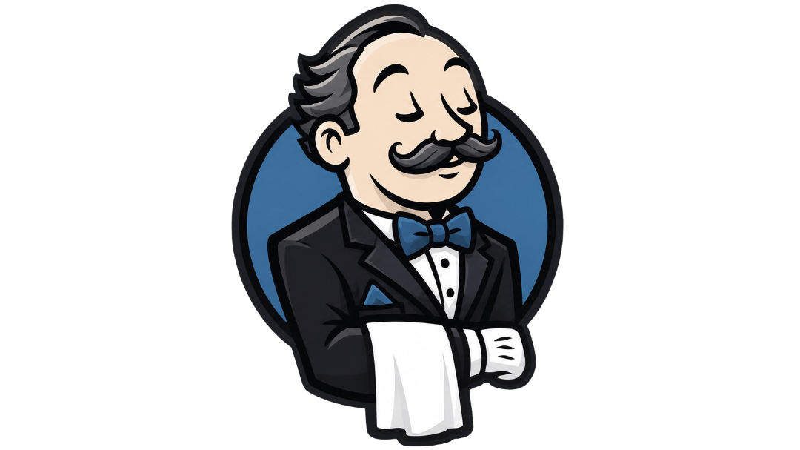

<p align="center">
  
</p>

<h1 align="center">Bernard</h1>

<p align="center">
  <strong>A self-hosted Discord bot and admin dashboard for your server.</strong><br>
  <em>Thoughtful server management, without the bloat.</em>
</p>

<p align="center">
  
  
  
</p>

<p align="center">
  
  
  
  
  
</p>

---

A self-hosted Discord bot plus admin dashboard for **one private server**. Bot, API and dashboard run in a single Node process on SQLite.

## Features

- **Permissions:** role-based rules on top of Discord, with wildcards (`admin:*`, `*`) and a `/permcheck` that shows which rule decided.
- **Moderation:** ban (including temporary bans), kick, timeout, warn, purge, slowmode, lock, roles, nicknames and announcements. Every action becomes a numbered mod case, including bans and kicks done in Discord's own UI.
- **Logs:** moderation, members, messages, voice, server and commands, each routed to its own channel and stored for searching.
- **Join-to-create voice:** public or private hubs, owner commands, and startup clean-up so a restart never leaves orphan channels.
- **Tenure and activity tiers:** up to 10 tiers that need both days in the server and recent activity, with stacking or highest-only modes and step-by-step demotion down to a floor.
- **Status embed:** a pinned message showing your Uptime Kuma monitors, with up/down alerts and ping roles.
- **Self-assign role panels:** buttons or a menu members use to pick their own roles.
- **That's crazy:** `/thatscrazy @friend` starts a quick vote; if it passes they're muted, deafened, kept out of voice or timed out for a bit, more each time it happens.
- **Issue reports:** members report problems from Discord, Bernard opens a [Belltower](https://github.com/bernie-sandler/Belltower) ticket and tells them when it's fixed. Or the button opens Belltower's submit page, and the dashboard lists what comes in.
- **Web dashboard:** Discord login, gated by the same permission nodes as the commands, with live updates. Everything configurable by command is configurable here too.

## Quick start

You need Docker and a Discord application. [Setup](docs/setup.md) walks through the Developer Portal step by step.

1. In the [Developer Portal](https://discord.com/developers/applications), create an application, enable the **Server Members** and **Message Content** intents, and add the redirect `${PUBLIC_BASE_URL}/api/auth/callback` under OAuth2.
2. Copy the example config and fill in at least `DISCORD_TOKEN`, `DISCORD_CLIENT_ID`, `GUILD_ID`, `DISCORD_CLIENT_SECRET`, `SESSION_SECRET` and `PUBLIC_BASE_URL`:

   ```bash
   cp .env.example .env
   ```

3. Start it:

   ```bash
   docker compose up -d --build
   ```

4. Invite the bot with the link from `pnpm invite-url` (also printed in the log), and drag its role above every role it should manage.
5. Only the owner and Administrators can use admin commands at first. Hand out access with `/permset`, for example:

   ```
   /permset node:dashboard:access role:@Mod value:true
   ```

The database lives in `./data/bernard.db` and migrations run on startup. Published images are at `ghcr.io/bernie-sandler/bernard` (`latest`, version tags, and `dev` for unreleased changes).

## Documentation

| Page                                       | What's in it                                                             |
| ------------------------------------------ | ------------------------------------------------------------------------ |
| [Setup](docs/setup.md)                     | Developer Portal, intents, environment variables, Docker, proxy, backups |
| [Commands](docs/commands.md)               | Command list and how moderation works                                    |
| [Permissions](docs/permissions.md)         | Nodes, wildcards and which rule wins                                     |
| [Logs](docs/logs.md)                       | Log types, retention and the message cache                               |
| [Voice](docs/voice.md)                     | Join-to-create hubs and owner commands                                   |
| [Tiers](docs/tiers.md)                     | Tenure, activity scoring and tier roles                                  |
| [Status embed](docs/status.md)             | Uptime Kuma status page, alerts and ping roles                           |
| [Role panels](docs/role-panels.md)         | Self-assign role buttons and menus                                       |
| [Issue reports](docs/issue-reports.md)     | Reporting problems to Belltower from Discord                             |
| [That's crazy](docs/thats-crazy.md)        | Vote-based voice penalties for friends who say crazy things              |
| [Dashboard](docs/dashboard.md)             | Setup, what each page needs, security, live updates                      |
| [Troubleshooting](docs/troubleshooting.md) | Common errors and fixes                                                  |
| [Development](docs/development.md)         | Local setup, scripts, adding a command, tests, project layout            |
| [CI and releases](docs/releasing.md)       | Branches, CI, releases and images                                        |

## Development

```bash
pnpm install
```

```bash
pnpm dev
```

Run `pnpm build:web && pnpm demo` to try the dashboard on fake data with no Discord at <http://localhost:3100>. See [Development](docs/development.md) for the rest. Changes are listed in the [CHANGELOG](CHANGELOG.md).
